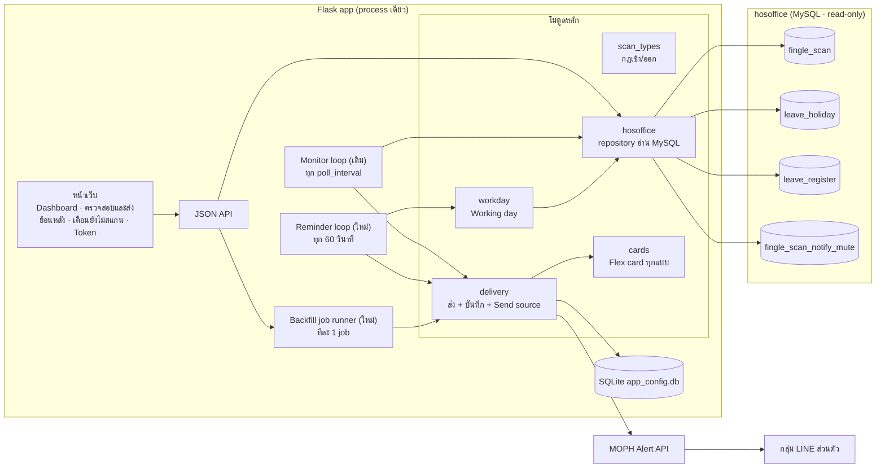
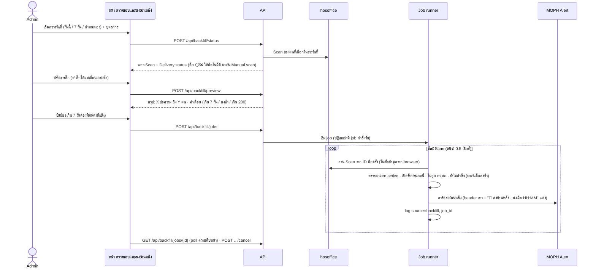
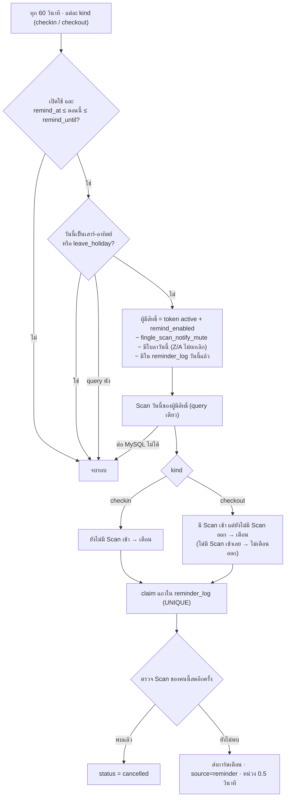

# Phase 2: ส่งย้อนหลัง, ตรวจสถานะการส่ง และเตือนยังไม่สแกน — สถาปัตยกรรม

> สถานะ: **ลงมือแล้ว** (6 พ.ย. 2569) — T1–T7 เสร็จ, test 173 ผ่าน · ศัพท์ทั้งหมดอ้างอิง [`CONTEXT.md`](../../CONTEXT.md)
> ได้มาจากการสัมภาษณ์ออกแบบ 3 รอบ (Q1–Q33) และการตรวจ schema ของ hosoffice แบบ read-only

## 1. เป้าหมายและขอบเขต

| ฟีเจอร์ | สรุป |
|---|---|
| **Delivery status (Recheck)** | ดูว่าแต่ละ Scan ของวัน/ช่วงวันที่เลือก ส่งสำเร็จ / ล้มเหลว / ถูกข้าม (พร้อมเหตุผล) / ไม่เคยส่ง |
| **Backfill (ส่งย้อนหลัง)** | เลือกบุคลากรและ Scan แล้วส่ง Flex card ย้อนหลัง พร้อมสรุปก่อนส่งและยืนยัน |
| **Missing-scan reminder (เตือนยังไม่สแกน)** | ถึงเวลาที่ตั้งแล้วยังไม่พบ Scan เข้า (หรือมีเข้าแต่ยังไม่มีออก) ในวันทำงาน → ส่งการ์ดสีส้ม |
| **แก้ bug ประเภท Scan** | รวมกฎเข้า/ออกเป็นที่เดียว แก้การ์ดที่แสดง `OUT` เป็นเข้างาน และสถิติ Dashboard ที่นับ `1` เป็นเข้างาน |

**นอกขอบเขต (phase 2b ขึ้นไป):** ตารางเวรและวันหยุดของพยาบาล, ใบลาครึ่งวันแบบละเอียด, การรู้ว่า "อ่านแล้ว" (MOPH API ไม่รองรับ), ระบบล็อกอิน

## 2. ข้อเท็จจริงที่กำหนดการออกแบบ

**MOPH Alert / หมอพร้อม Notify** (จากโค้ดชุมชน ไม่มีเอกสารทางการ)
- response คือ `{message, message_code}` เท่านั้น: ไม่มี message id, ไม่มี API สถานะส่ง/อ่าน, ไม่มี webhook → **Delivery status สูงสุดที่รู้ได้คือ "MOPH รับเรื่อง"**
- Flex message อาจถึงช้าได้ (มีรายงาน ~19 นาที) → ข้อความในการ์ดเตือนต้องไม่ผูกกับ "ตอนนี้" แบบเป๊ะ (ใช้ "ตรวจเมื่อ 09:30")
- token ทุกตัวเป็นกลุ่ม LINE ส่วนตัวของบุคลากรคนเดียว (ยืนยันโดยผู้ใช้, Q28)

**hosoffice (MySQL, อ่านอย่างเดียว)**

| ตาราง | ใช้ทำอะไร | หมายเหตุจากข้อมูลจริง |
|---|---|---|
| `fingle_scan` | Scan | `SCAN_TYPE`: เข้า = `0`,`4`,`IN` · ออก = `1`,`5`,`OUT` · `ISINPUT`: FACESCAN / SIGN / MANUAL · `ACTIVE` **ไม่ใช่** flag การลบ (ว่างทั้งหมดใน FACESCAN) |
| `leave_holiday` | วันหยุดราชการ | `DATE_HOLIDAY`, `ACTIVE='True'` มีข้อมูลล่วงหน้า |
| `leave_register` | ใบลา | นับเป็นลา: `LEAVE_STATUS_CODE IN ('Z','A')` และ `LEAVE_CANCEL_STATUS <> 'True'` และวันนี้อยู่ใน `LEAVE_DATE_BEGIN..END` · ครึ่งวัน (`DAY_TYPE_ID` 02/03) = ข้ามทั้งวันใน phase นี้ |
| `fingle_scan_notify_mute` | รายชื่อคนขอปิดแจ้งเตือน | ตอนนี้ 0 แถว แต่เคารพในทุกการส่ง |
| `fingle_scan_forgot` | Forgot-scan request | ไม่ใช้โดยตรง แต่ Scan ที่อนุมัติจะเข้ามาเป็น Manual scan (`ISINPUT='MANUAL'`) ช้าได้หลายวัน |

> ⚠️ **สมมติฐานที่ต้องยืนยันตอนลงมือ:** `leave_register.LEAVE_PERSON_ID` คือรหัสเดียวกับ `fingle_scan.PERSON_ID` (ตรวจด้วยการนับ join แบบ aggregate ก่อนใช้งาน)

## 3. ภาพรวมสถาปัตยกรรม



**หลักการ**
1. **hosoffice อ่านอย่างเดียว** และผ่านโมดูล `hosoffice.py` ที่เดียว (เป็นจุด mock ใน test)
2. **การส่งทุกแบบผ่าน `delivery.py`** ซึ่งเลือกการ์ด, เรียก MOPH, บันทึก log พร้อม **Send source** → โควตา/กันซ้ำ/สถานะ คำนวณจากที่เดียว
3. **ตรรกะการตัดสินใจเป็นฟังก์ชันล้วน** (ไม่แตะ DB/เวลา): `decide_reminders(...)`, `delivery_status(...)` → test ได้ละเอียดโดยไม่ต้องต่อ MySQL
4. **Fail closed:** ต่อ hosoffice ไม่ได้ / query วันหยุดหรือใบลาพัง → **ไม่เตือน** ในรอบนั้น (ห้ามตีความว่า "ไม่มี Scan" = "ลืมสแกน")
5. **Claim ก่อนส่ง** (แบบเดียวกับ checkpoint ของ Monitor): จองแถวใน log ด้วย unique key ก่อนเรียก API → restart หรือรันซ้อนก็ไม่ส่งซ้ำ

## 4. โครงสร้างโมดูล

```
finger_scan_notify/
├── scan_types.py     ใหม่ · CHECKIN={'0','4','IN'} CHECKOUT={'1','5','OUT'} · direction(), label()
├── hosoffice.py      ใหม่ · ทุก query ไป MySQL (ย้าย get_*_from_mysql จาก database.py มาที่นี่)
├── workday.py        ใหม่ · is_working_day(date, person) จากเสาร์-อาทิตย์ + leave_holiday + leave_register
├── delivery.py       ใหม่ · send_card(kind, scan|person, token, source, job_id) → log + ผลลัพธ์
├── cards.py          ใหม่ · ย้าย build_flex_message มา + build_backfill_card + build_reminder_card
├── backfill.py       ใหม่ · delivery_status() + job runner (thread, throttle, cancel)
├── reminders.py      ใหม่ · decide_reminders() (ล้วน) + reminder loop
├── flex_theme.py     ขยาย · สีชุด reminder_in / reminder_out / backfill
├── notifier.py       เหลือเฉพาะ adapter ส่ง HTTP (LINE Notify เดิม + MOPH) — ไม่มีตรรกะ
├── database.py       SQLite เท่านั้น + ตารางใหม่
├── app.py            routes เพิ่ม (หรือแยก blueprint: routes_backfill.py, routes_reminders.py)
└── templates/        backfill.html · reminders.html · _flex_editor.html (เพิ่ม 3 ชุดสี)
```

## 5. แบบข้อมูล (SQLite)

```sql
-- notify_logs: เพิ่มคอลัมน์ (migration แบบเดิมใน init_db)
ALTER TABLE notify_logs ADD COLUMN source TEXT DEFAULT 'live';   -- live | backfill | reminder | test
ALTER TABLE notify_logs ADD COLUMN job_id INTEGER;                -- backfill_jobs.id

-- เหตุผลที่ไม่ได้ส่ง (สถานะ "ถูกข้าม" ใน Recheck) — แยกจาก notify_logs ไม่ให้ปนสถิติการส่ง
CREATE TABLE scan_skips (
  id INTEGER PRIMARY KEY AUTOINCREMENT,
  scan_id INTEGER, person_id INTEGER, source TEXT,
  reason TEXT,          -- stale | duplicate | quota | type_off | muted | no_token | unknown_type
  created_at TIMESTAMP DEFAULT CURRENT_TIMESTAMP
);
CREATE INDEX idx_skips_scan ON scan_skips(scan_id);

-- person_tokens: เปิดรับการเตือน (opt-in, ค่าเริ่มต้นปิด — Q22)
ALTER TABLE person_tokens ADD COLUMN remind_enabled INTEGER DEFAULT 0;

-- ตั้งค่าการเตือน 2 แบบ
CREATE TABLE reminder_config (
  kind TEXT PRIMARY KEY,          -- 'checkin' | 'checkout'
  enabled INTEGER DEFAULT 0,
  remind_at TEXT,                 -- 'HH:MM' เช่น 09:30 / 17:00
  remind_until TEXT,              -- 'HH:MM' เช่น 12:00 / 22:00
  button_url TEXT DEFAULT '',     -- ว่าง = ไม่มีปุ่ม (ต้องเป็น https://)
  button_label TEXT DEFAULT 'สแกนเข้างานตอนนี้'
);

-- การเตือนที่ส่ง/จองแล้ว: unique ต่อ คน+วัน+แบบ → วันละครั้ง (Q11) และกันส่งซ้ำข้าม restart
CREATE TABLE reminder_log (
  id INTEGER PRIMARY KEY AUTOINCREMENT,
  person_id INTEGER, work_date TEXT, kind TEXT,
  status TEXT,                    -- claimed | success | error | cancelled (พบ Scan ตอนตรวจซ้ำ)
  http_code INTEGER, response TEXT,
  created_at TIMESTAMP DEFAULT CURRENT_TIMESTAMP,
  UNIQUE(person_id, work_date, kind)
);

-- งานส่งย้อนหลัง
CREATE TABLE backfill_jobs (
  id INTEGER PRIMARY KEY AUTOINCREMENT,
  date_from TEXT, date_to TEXT,
  total INTEGER, sent INTEGER DEFAULT 0, failed INTEGER DEFAULT 0, skipped INTEGER DEFAULT 0,
  status TEXT,                    -- running | done | cancelled | error
  created_at TIMESTAMP DEFAULT CURRENT_TIMESTAMP, finished_at TIMESTAMP
);
```

ค่าเริ่มต้น `reminder_config`: checkin 09:30–12:00, checkout 17:00–22:00 (Q14, Q24) · ปิดไว้จนกว่า admin เปิด

## 6. กฎกลาง

**ประเภท Scan** (`scan_types.py`, Q30) — ใช้ทุกที่: การ์ด, Dashboard, Monitor, Recheck, Reminder

| SCAN_TYPE | ทิศทาง | ป้ายบนการ์ด |
|---|---|---|
| `0`, `IN` | เข้า | Theme `checkin_label` |
| `4` | เข้า | เข้างานพิเศษ |
| `1`, `OUT` | ออก | Theme `checkout_label` |
| `5` | ออก | ออกงานพิเศษ |
| อื่น ๆ | ไม่ทราบ | **ไม่ส่ง** บันทึก skip `unknown_type` (เดิม default เป็นเข้างาน — ข้อเสนอของผม ยืนยันได้ในรีวิว) |

**Delivery status ของ Scan หนึ่งรายการ** (คำนวณ, ไม่เก็บ)
1. มี log `success` (source ใดก็ได้) → ✅ ส่งสำเร็จ (แสดงเวลาและ source ล่าสุด)
2. มี log แต่ล่าสุดเป็น `error` → ❌ ล้มเหลว (แสดง http_code/response)
3. มีใน `scan_skips` → ⏭️ ถูกข้าม (แสดงเหตุผลล่าสุด)
4. ไม่มีอะไรเลย → ⚪ ไม่เคยส่ง

**โควตาต่อคน** (`max_per_person_hour`) นับเฉพาะ `source='live'` (Q7)

## 7. Flow

### 7.1 Monitor (เดิม — ปรับ)
- ใช้ `scan_types` แทน `SCAN_TYPE_MAP` · ทิศทางไม่ทราบ → skip `unknown_type`
- ทุกการข้ามบันทึก `scan_skips` (stale, duplicate, quota, type_off, muted) แทนตัวนับรวมอย่างเดียว
- เคารพ `fingle_scan_notify_mute`
- ส่งผ่าน `delivery.send_card(source='live')`

### 7.2 Recheck + Backfill



**ตัวกัน:** ส่งได้ไม่เกิน 200 ข้อความต่อ job · ช่วงวันเกิน 7 วันต้องพิมพ์ยืนยัน (Q25) · job ละ 1 ตัวพร้อมกัน · เลือกได้เฉพาะบุคลากรที่มี token

### 7.3 Missing-scan reminder



**การ์ดเตือน** (Q32)
- *เข้า:* header ไล่สีส้ม ⚠️ "ยังไม่พบการสแกนเข้างาน" · ชื่อ, ตำแหน่ง · "ตรวจเมื่อ 09:30 · ศุกร์ 6/11/2569" · **"กรุณาสแกนเข้างานทันที"** · เล็กสีเทา "หากวันนี้เป็นวันหยุดหรือวันลาของคุณ ไม่ต้องดำเนินการ" · ปุ่มถ้ามี `button_url`
- *ออก:* โทน amber · "ยังไม่พบการสแกนออกงาน" · "อย่าลืมสแกนออกก่อนกลับ" · เล็ก "หากยังปฏิบัติงานอยู่ ไม่ต้องดำเนินการ"
- สีทั้งหมดปรับได้ใน Theme editor

## 8. หน้าเว็บและ API

**เมนูใหม่ใน sidebar:** 🔁 ตรวจสอบและส่งย้อนหลัง · ⏰ เตือนยังไม่สแกน

| Method | Path | หน้าที่ |
|---|---|---|
| GET | `/backfill` | หน้า Recheck + ส่งย้อนหลัง |
| POST | `/api/backfill/status` | `{date_from, date_to, person_ids}` → แถว Scan + Delivery status |
| POST | `/api/backfill/preview` | `{scan_ids, resend_ids}` → สรุปและคำเตือน (ไม่ส่ง) |
| POST | `/api/backfill/jobs` | เริ่ม job (`confirm_text` เมื่อเกิน 7 วัน) |
| GET | `/api/backfill/jobs/<id>` | ความคืบหน้า |
| POST | `/api/backfill/jobs/<id>/cancel` | หยุด job |
| GET | `/reminders` | ตั้งค่า 2 การ์ด (เวลาเตือน, เตือนได้ถึง, URL ปุ่ม, เปิด/ปิด) + เลือกคนที่รับเตือน + รายการเตือนวันนี้ |
| GET/POST | `/api/reminders/config` | อ่าน/บันทึกตั้งค่า (validate เวลา `HH:MM`, `remind_at < remind_until`, URL ต้อง https) |
| POST | `/api/reminders/recipients` | `{person_ids, enabled}` เปิด/ปิดหลายคนพร้อมกัน |
| GET | `/api/reminders/today` | วันนี้: ใครถูกเตือน / ถูกยกเลิกเพราะสแกนแล้ว / ถูกข้ามเพราะลาหรือ mute |
| POST | `/api/reminders/preview` | dry-run: ถ้าเตือนตอนนี้จะเตือนใครบ้าง (ไม่ส่ง) |

## 9. ความปลอดภัยและตัวกัน (สรุป)

| ความเสี่ยง | ตัวกัน |
|---|---|
| ต่อ hosoffice ไม่ได้ แล้วเตือนทุกคนว่า "ยังไม่สแกน" | fail closed: ข้ามรอบ |
| เตือนคนที่ลา/วันหยุด/เข้าเวร | วันหยุดราชการ + ใบลา + opt-in (ปิดเป็นค่าเริ่มต้น) + ข้อความ "หากเป็นวันหยุด ไม่ต้องดำเนินการ" |
| เตือนซ้ำ / restart กลางรอบ | `reminder_log` UNIQUE(person, date, kind) + claim ก่อนส่ง |
| เตือนทั้งที่เพิ่งสแกน | ตรวจ Scan สดซ้ำหลัง claim ก่อนส่ง |
| ส่งย้อนหลังท่วม (แบบเหตุ 4 พ.ย.) | สรุปก่อนส่ง, ยืนยัน, เพดาน 200, เกิน 7 วันต้องพิมพ์ยืนยัน, job เดียว |
| ส่งย้อนหลังกินโควตาการแจ้งเตือนสด | โควตานับเฉพาะ `source='live'` |
| คนขอปิดแจ้งเตือน | เคารพ `fingle_scan_notify_mute` ทุก source |
| ไม่มีระบบล็อกอิน | คงความเสี่ยงเดิม (แยกเป็นงานของตัวเอง) — หน้าที่ส่งข้อความได้ทุกหน้ามียืนยันก่อนส่ง |

## 10. แผนการทดสอบ (pytest, ใช้ fixture `tmp_db` เดิม + mock `hosoffice`/`requests`)

- `scan_types`: ทุกรหัสใน `fingle_scan_type` + รหัสแปลก
- `workday`: เสาร์-อาทิตย์, วันหยุดราชการ, ใบลา Z/A/X/N/ยกเลิก/ครึ่งวัน, query พัง → fail closed
- `decide_reminders` (ล้วน): ยังไม่เข้า, เข้าแล้ว, เข้าแต่ไม่ออก, ไม่เข้าเลย (ไม่เตือนออก), mute, opt-out, นอกช่วงเวลา, เปิดแอปช้า, เคยเตือนแล้ว
- reminder loop: claim → พบ Scan ตอนตรวจซ้ำ → cancelled; MySQL ล่ม → ไม่ส่ง
- `delivery_status`: 4 สถานะ + ลำดับความสำคัญ
- backfill job: เพดาน 200, กันส่งซ้ำ, ส่งซ้ำเมื่อติ๊ก, cancel, job ซ้อนถูกปฏิเสธ, อ่าน Scan ใหม่จาก ID
- การ์ดใหม่ 3 แบบ: ผ่าน validator เดิม (สี hex, ไม่มี text ว่าง, altText ≤ 400, mega)
- โควตา: backfill/reminder ไม่ทำให้ live ถูกข้าม
- Dashboard: สถิติเข้า/ออกถูกต้องตาม `scan_types`

## 11. ลำดับงาน

| # | งาน | พึ่ง |
|---|---|---|
| T1 | `scan_types.py` + แก้การ์ด/Dashboard/Monitor ให้ใช้กฎเดียว | – |
| T2 | `hosoffice.py` (ย้าย query) + `delivery.py` + `source`/`scan_skips` + โควตาเฉพาะ live + mute | T1 |
| T3 | `cards.py`: การ์ดส่งย้อนหลัง + การ์ดเตือน 2 แบบ + ขยาย Theme editor | T1 |
| T4 | Recheck + Backfill: API, job runner, หน้า `/backfill` | T2, T3 |
| T5 | `workday.py` + ตรวจสมมติฐาน `LEAVE_PERSON_ID` + `reminders.py` (decide + loop) | T2 |
| T6 | หน้า `/reminders` + `remind_enabled` ในหน้า Token + dry-run | T3, T5 |
| T7 | README + อัปเดต CONTEXT.md | ทั้งหมด |

## 12. ความเสี่ยงที่ยังเหลือ / phase 2b

- **พยาบาลและคนเข้าเวร:** ยังไม่รองรับ — ห้ามเปิดรับการเตือนจนกว่าจะเชื่อมตารางเวร (`wl_shift_*` / `schedule_*` — ยังไม่ได้ตรวจโครงสร้าง; `fingle_shift_person` และ `fingle_work_time_*` ว่าง)
- **ใบลาครึ่งวัน:** phase นี้ข้ามทั้งวัน (ครึ่งเช้าควรข้ามแค่เตือนเข้า, ครึ่งบ่ายข้ามแค่เตือนออก)
- **รหัสใบลา `D`/`E`/`S`:** ไม่ทราบความหมาย ไม่นับเป็นลา
- **Flex ถึงช้า:** ควบคุมไม่ได้ (ฝั่ง MOPH)
- **แอปต้องเปิดอยู่:** การเตือนทำงานเฉพาะตอนแอปรัน (เปิดช้ายังเตือนได้ภายในช่วงเวลา)
