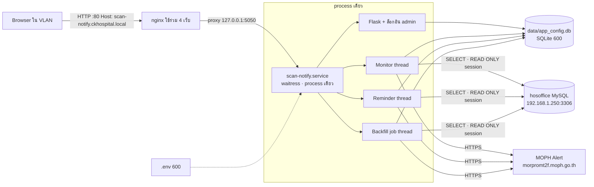

# Phase 3 — ขึ้น Server (AlmaLinux 9) แบบเดียวกับ ipd-overview / ipd-food

**สถานะ:** ลงมือแล้ว (7 พ.ย. 2569) — T1–T6 เสร็จ, T7 รอผู้ใช้สร้าง repo · สคริปต์ `deploy/*.sh` ยังไม่ได้ทดสอบบน AlmaLinux จริง

**ต่างจากแผนระหว่างลงมือ:**
- `deploy.sh` **ไม่คืน SQLite จากไฟล์สำรองอัตโนมัติ** เมื่อ deploy พัง: ถ้ารุ่นใหม่ส่งแจ้งเตือนไปแล้ว การคืนไฟล์จะย้อน `last_scan_id` และลบ log → Monitor ส่งซ้ำ
  schema ของระบบนี้เปลี่ยนแบบเพิ่มอย่างเดียว รุ่นเก่าจึงทำงานบนฐานข้อมูลใหม่ได้ · rollback restart เฉพาะเมื่อได้ restart ไปแล้ว (ไม่ฆ่างานส่งย้อนหลัง)
- การปิด job ส่งย้อนหลังที่ค้าง ย้ายจาก `init_db` ไป `close_stuck_backfill_jobs()` ที่เรียกตอนเปิดแอปเท่านั้น
  (เดิม `manage.py backup` ตอน 02:30 จะไปปิด job ที่กำลังรันจริง — test ของ `can-restart` จับได้)
- เพิ่ม `manage.py reset-checkpoint` (หลังกู้ไฟล์สำรอง ไม่ส่ง scan เก่าซ้ำ) เพราะ Dashboard ไม่มีปุ่ม Reset
- หน้าตั้งค่าฐานข้อมูลเดิมเขียนรหัส MySQL ลงใน HTML (`value=`) — แก้ให้ไม่ส่งรหัสออกไปเลยทั้งสองโหมด (ช่องว่าง = ใช้รหัสเดิม)
- เครื่อง Windows ได้ `.env` ที่คงพฤติกรรมเดิมไว้จนถึงวันย้าย (`MONITOR_AUTOSTART=1`, `LISTEN_HOST=0.0.0.0`, hosoffice ยังอ่านจาก SQLite)
**ต้นแบบ:** `C:\Dev\Projects\IPD Overview\SERVER-SETUP-ALMALINUX.md`, `DEPLOYMENT.md`, `deploy/*` (อ่านอย่างเดียว ไม่ได้แก้)
**ADR:** [0001 — process เดียว เครื่องเดียว](../adr/0001-single-process.md)

## 1. เป้าหมาย

ย้ายระบบจากเครื่อง Windows ที่รันด้วยมือ (`python app.py`, port 5050) ไปเป็นบริการบน dashboard-srv
ให้มีรูปแบบเดียวกับระบบอื่นบนเครื่องเดียวกัน: ชื่อเครื่องเฉพาะ ผู้ใช้ระบบแยก ความลับใน `.env` deploy ตาม git tag ด้วยคำสั่งเดียว ย้อนรุ่นได้
และปิดช่องโหว่ที่ยอมรับได้บนเครื่องส่วนตัว แต่ยอมรับไม่ได้บน Server ในวง VLAN (ไม่มีล็อกอิน, ใช้ `root` ของ hosoffice, ความลับในโค้ด)

## 2. ข้อตกลง (จากการคุย Q1–Q17)

| # | เรื่อง | ข้อตกลง |
|---|---|---|
| Q1 | ชื่อและที่ติดตั้ง | `scan-notify.ckhospital.local` บน dashboard-srv · ผู้ใช้ระบบ `scannotify` · โฟลเดอร์ `/var/www/scan-notify` |
| Q2/Q17 | git | `git init` ที่ `notify_fingle_scan-master` → private repo `nuttapong39/finger_scan_notify` (ผู้ใช้สร้าง repo และ deploy key อ่านอย่างเดียว) |
| Q3 | การรัน | waitress process เดียว ฟัง `127.0.0.1:5050` เป็น systemd `scan-notify.service` หลัง nginx (ADR 0001) |
| Q4/Q9 | ล็อกอิน | ในแอป บัญชีเดียวชื่อ `admin` |
| Q10 | รหัสเริ่มต้น | คำสั่งบน Server สุ่มรหัสชั่วคราว แสดงครั้งเดียว เก็บแค่ hash |
| Q11 | บังคับเปลี่ยน | pop-up ปิดไม่ได้ (เปลี่ยนรหัส / ออกจากระบบ) + Server บล็อกทุกหน้าและ API จนกว่าจะเปลี่ยน · ≥ 10 ตัว ไม่ซ้ำรหัสชั่วคราว พิมพ์ 2 ครั้ง · เมนู "🔑 เปลี่ยนรหัสผ่าน" (ต้องใส่รหัสเดิม) |
| Q12 | ลืมรหัส | `manage.py reset-admin` บน Server → รหัสชั่วคราวใหม่ + บังคับเปลี่ยน |
| Q13 | กันเดา / session | ผิด 5 ครั้งล็อก 15 นาทีต่อ IP · หมดอายุเมื่อไม่ใช้ 8 ชม. · cookie HttpOnly + SameSite=Lax (ไม่ Secure เพราะ HTTP) · POST ต้องมี Origin/Referer เป็นของระบบ · `/login` เปิดได้ หน้าอื่นพาไป login |
| Q14 | จำกัด IP | ไม่จำกัด (รหัสอย่างเดียว) |
| Q5 | บัญชี hosoffice | ใช้ `root` ไปก่อน + บังคับ `SET SESSION TRANSACTION READ ONLY` ในโค้ด (ขอ role SELECT ภายหลัง) |
| Q6 | ความลับ | `.env` (600): `SECRET_KEY`, `HOSOFFICE_HOST/PORT/USER/PASSWORD/DATABASE` · หน้าตั้งค่า DB แสดงค่าการเชื่อมต่ออย่างเดียว แก้ได้เฉพาะค่าที่ไม่ใช่ความลับ (poll, อายุ scan, โควตา, ชื่อตาราง) · key ของ Person token อยู่ใน SQLite (600) ต่อ |
| Q15 | เครื่องพัฒนา | Monitor/การเตือนเริ่มเองเฉพาะ `MONITOR_AUTOSTART=1` · แถบแดง "เครื่องนี้ไม่ใช่เครื่องหลัก" เมื่อกดเริ่ม Monitor บนเครื่องที่ไม่ได้ตั้ง · มี `.env` แล้วลบรหัส MySQL ที่ค้างใน SQLite |
| Q7 | ย้ายเครื่อง | ติดตั้งโดย Monitor ปิด → หยุดแอปบน Windows (เปิดด้วยมือ ไม่มี autostart — ตรวจแล้ว) → คัดลอก `app_config.db` → เปิด Monitor · ทำนอกช่วงเข้า-ออกงาน |
| Q8 | ชุด deploy | ครบแบบ ipd-overview ปรับเป็น Python + `deploy.sh` ไม่ restart ขณะ job Backfill รัน · sudoers เฉพาะ `systemctl restart scan-notify` · preflight ตรวจต่อ MySQL 3306 และ MOPH 443 ได้ |
| ค่าเริ่มต้น | | Python 3.11 (dnf) ใน `.venv` · Asia/Bangkok + chrony · HTTP ในวง VLAN · สำรองรายวัน 02:30 เก็บ 30 ไฟล์ 600 · nginx ใช้ `reload` เท่านั้น |

## 3. ภาพรวม

## 4. งานโค้ด

| โมดูล | งาน |
|---|---|
| `settings.py` (ใหม่) | โหลด `.env` (python-dotenv): `SECRET_KEY` (ไม่มี = ไม่ยอมเริ่มในโหมด production), `HOSOFFICE_*`, `MONITOR_AUTOSTART`, `APP_ENV` |
| `auth.py` (ใหม่) | ตาราง `admin_account` (hash ด้วย werkzeug, `must_change`, `changed_at`) และ `login_attempts` · `before_request` guard: ไม่ล็อกอิน → `/login` (API → 401 JSON) · `must_change` → 403 ยกเว้น `/account/password`, `/logout`, static · ตรวจ Origin/Referer ของทุก non-GET · lockout 5/15 นาที · idle 8 ชม. |
| `manage.py` (ใหม่) | `init-admin` (ครั้งแรก, ไม่ทับถ้ามีแล้ว) และ `reset-admin` → พิมพ์รหัสชั่วคราวครั้งเดียว · `backup --keep=30` (VACUUM INTO, 600) · `check` (อ่าน `.env`, ต่อ hosoffice แบบ READ ONLY, `SELECT 1` จาก 4 ตาราง, ต่อ MOPH ได้ — ไม่ส่งข้อความ) |
| `serve.py` (ใหม่) | จุดเข้าของ Server: `init_db` → เริ่ม Monitor/การเตือนถ้า `MONITOR_AUTOSTART=1` → `waitress.serve(host=127.0.0.1, port=5050, threads=8)` · `app.py __main__` ใช้กฎเดียวกัน |
| `hosoffice.py` | ค่าเชื่อมต่อจาก `.env` ก่อน (fallback SQLite เฉพาะเมื่อไม่มี `.env`) · ทุก connection รัน `SET SESSION TRANSACTION READ ONLY` ถ้าคำสั่งนี้ล้ม = ไม่ใช้ connection นั้น (fail closed) |
| `database.py` | migration: `admin_account`, `login_attempts` · มี `HOSOFFICE_PASSWORD` ใน `.env` → ล้าง `db_config.password` |
| `app.py` | ใช้ `settings.SECRET_KEY` · `/config/database` แก้ได้เฉพาะค่าที่ไม่ใช่ความลับ · แถบแดงเมื่อเริ่ม Monitor บนเครื่องที่ไม่ใช่เครื่องหลัก · ลงทะเบียน auth |
| templates | `login.html`, pop-up บังคับเปลี่ยนรหัสใน `base.html`, เมนู 🔑 และ "ออกจากระบบ", หน้าเปลี่ยนรหัส |
| `requirements.txt` | เพิ่ม `waitress` · ลบ `flask-apscheduler` ถ้าไม่ได้ใช้ (ตรวจก่อน) |

## 5. ชุด deploy (`deploy/`)

| ไฟล์ | จาก ipd-overview | ปรับ |
|---|---|---|
| `scan-notify.service` | (ใหม่ — แทน php-fpm pool) | `User=scannotify`, `WorkingDirectory=.../finger_scan_notify`, `ExecStart=.venv/bin/python serve.py`, `Restart=on-failure`, `TZ=Asia/Bangkok`, hardening (`NoNewPrivileges`, `ProtectSystem=strict`, `ReadWritePaths=data logs`) |
| `nginx-scan-notify.conf` | nginx-ipd-overview.conf | `proxy_pass http://127.0.0.1:5050` · deny ไฟล์ความลับ · header กัน frame/sniff · `server_tokens off` · `proxy_read_timeout 120` |
| `sudoers-scan-notify` | sudoers-ipd-overview | `scannotify ALL=(root) NOPASSWD: /usr/bin/systemctl restart scan-notify, /usr/bin/systemctl is-active scan-notify` |
| `scan-notify.cron` | ipd-overview.cron | 02:30 `manage.py backup --keep=30` |
| `preflight.sh` | preflight.sh | Python 3.11 + venv, เขตเวลา/NTP, ผู้ใช้/สิทธิ์ (`.env` 600, `data/` เขียนได้), SELinux, `.env` ครบ, `manage.py check` (MySQL 3306 READ ONLY, MOPH 443) |
| `deploy.sh` | deploy.sh | ตรวจ `.env` และ git สะอาด → fetch → `py_compile` รุ่นใหม่ในโฟลเดอร์ชั่วคราว → **หยุดถ้า job Backfill รันอยู่** → สำรอง SQLite → ff-only → `pip install -r` → restart → smoke · พังแล้วย้อนรุ่น + dependency (+ คืน SQLite เฉพาะเมื่อ schema เปลี่ยน) |
| `smoke_after_deploy.sh` | smoke_after_deploy.sh | `.env`/`*.db`/`.git`/`deploy/*` เปิดไม่ได้ · `/login` 200 · `/`, `/dashboard`, `/backfill`, `/reminders`, `/config/tokens`, `/api/logs` ไม่ล็อกอิน → 302/401 · header ไม่เปิดเผยเวอร์ชัน · service active · Monitor ทำงาน (อ่านจาก service log) |
| `SERVER-SETUP-ALMALINUX.md`, `DEPLOYMENT.md` | ชื่อเดียวกัน | ขั้นติดตั้งครั้งแรก + ย้ายจาก Windows (Q7) · อัปเดต/ย้อนรุ่น/สำรอง/กู้/reset รหัส |

SELinux: ให้ nginx ต่อ upstream `127.0.0.1:5050` ด้วย `semanage port -a -t http_port_t -p tcp 5050` (เลี่ยงการเปิด `httpd_can_network_connect` ที่กระทบทุกเว็บ) — preflight ตรวจ และเอกสารมีทางสำรองถ้าวิธีนี้ไม่พอ

## 6. ขั้นย้ายเครื่อง (cutover)

1. ติดตั้ง Server ตาม `SERVER-SETUP-ALMALINUX.md` โดย `MONITOR_AUTOSTART=0` · preflight ผ่าน
2. นอกช่วงเข้า-ออกงาน: หยุด `python app.py` บน Windows (ปิดหน้าต่าง / หยุด process) — ยืนยันว่า port 5050 ไม่ฟังแล้ว
3. คัดลอก `data/app_config.db` ขึ้น Server (`scp`) → `chmod 600` → `init_db` ลบรหัส MySQL ที่ค้าง
4. ตั้ง `MONITOR_AUTOSTART=1` → restart → smoke ผ่าน → ล็อกอิน admin เปลี่ยนรหัส → ส่งทดสอบไป token ของตัวเอง
5. scan ระหว่างช่วงย้าย: Monitor ทำต่อจาก `last_scan_id` (ไม่เกิน 180 นาที) · ที่ตกหล่นใช้หน้า 🔁 ส่งย้อนหลัง
6. Windows: ไม่ตั้ง `MONITOR_AUTOSTART` (เป็นเครื่องพัฒนา)

## 7. แผนทดสอบ (TDD ที่รอยต่อ)

- **auth:** ไม่ล็อกอิน → หน้า 302 / API 401 · ล็อกอินถูก/ผิด · ผิด 5 ครั้งล็อก (ครั้งที่ 6 แม้รหัสถูกก็เข้าไม่ได้) · หมดเวลาล็อกแล้วเข้าได้ · `must_change` บล็อกทุก route ยกเว้นเปลี่ยนรหัส/ออก · เงื่อนไขรหัสใหม่ · เปลี่ยนแล้วรหัสเก่าใช้ไม่ได้ · idle 8 ชม. · POST ไม่มี/ผิด Origin → 403 · ทุก route ที่ลงทะเบียนไว้ถูกป้องกัน (เดิน `app.url_map` อัตโนมัติ — route ใหม่ในอนาคตจะไม่หลุด)
- **manage.py:** `init-admin` ไม่ทับบัญชีเดิม · `reset-admin` ตั้ง `must_change` · ไม่เก็บรหัสเป็นข้อความ · backup สิทธิ์ 600 และเก็บ N ไฟล์
- **settings / hosoffice:** `.env` ชนะ SQLite · ไม่มี `SECRET_KEY` ในโหมด production = ไม่เริ่ม · connection รัน READ ONLY ก่อนคำสั่งแรก และถ้าล้ม = ไม่ query · ล้างรหัสใน SQLite เมื่อมี `.env`
- **autostart:** `MONITOR_AUTOSTART` ไม่ตั้ง → ไม่เริ่ม thread ใด
- **test เดิม 177 ตัวต้องผ่าน** (fixture ล็อกอินให้ test client)
- สคริปต์ `deploy/*.sh`: `bash -n` + shellcheck ถ้ามี — **ทดสอบบน AlmaLinux จริงโดยผู้ใช้**

## 8. งานย่อย

| # | งาน | ขึ้นกับ |
|---|---|---|
| T1 | `git init` + commit สถานะปัจจุบัน (phase 1–2 + logo) ก่อนแก้ — เป็นจุดตั้งต้นของ `/code-review` | — |
| T2 | `settings.py` + `.env.example` + `hosoffice` READ ONLY + ลบรหัสใน SQLite | T1 |
| T3 | `auth.py` + หน้า login / pop-up / เปลี่ยนรหัส + `manage.py init-admin/reset-admin` | T2 |
| T4 | `serve.py` + `MONITOR_AUTOSTART` + แถบเตือนเครื่องไม่ใช่หลัก + waitress | T2 |
| T5 | `manage.py backup/check` | T2 |
| T6 | `deploy/*` + `SERVER-SETUP-ALMALINUX.md` + `DEPLOYMENT.md` + README | T3–T5 |
| T7 | push ขึ้น `nuttapong39/finger_scan_notify` (เมื่อผู้ใช้สร้าง repo แล้ว) + tag `v1.0.0` | T6 |

## 9. สิ่งที่ยังไม่ทำ / ความเสี่ยง

- บัญชี `root` ของ hosoffice ยังเขียนได้ ด่านกันคือ READ ONLY session ในโค้ดเท่านั้น → ขอ role SELECT เฉพาะ 4 ตารางเมื่อพร้อม
- HTTP ในวง VLAN: รหัส admin ส่งเป็นข้อความธรรมดาในเครือข่าย (เหมือนระบบอื่นบนเครื่อง) → เปลี่ยนเป็น HTTPS เมื่อเครื่องกลางพร้อม
- บัญชีเดียวใช้ร่วม: ไม่รู้ว่าใครกดส่งย้อนหลัง
- หน้า `/debug` ส่งไปยัง URL ใดก็ได้ด้วย key ที่กรอก — อยู่หลังล็อกอินแล้ว แต่ควรพิจารณาปิดใน production
- ไฟล์ SQLite และไฟล์สำรองมี key ของ Person token ทั้งหมด → สิทธิ์ 600 และคัดลอกออกนอกเครื่องอย่างระวัง
